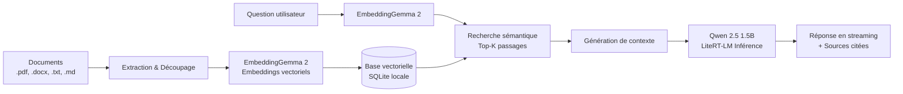

# 🧠 Edge AI Test — Assistant RAG On-Device

[](https://flutter.dev)
[](https://dart.dev)
[](https://ai.google.dev/edge/litert)
[](#-pourquoi-le-on-device-)
[](#)

> **Application modèle Flutter démontrant un pipeline RAG (*Retrieval-Augmented Generation*) complet s'exécutant 100 % en local sur mobile, sans aucun serveur ni API cloud.**

---

## 📋 Table des matières

- [Aperçu](#-aperçu)
- [Pourquoi le On-Device ?](#-pourquoi-le-on-device-)
- [Fonctionnalités principales](#-fonctionnalités-principales)
- [Architecture & Modèles d'IA](#-architecture--modèles-dia)
  - [Pipeline RAG](#pipeline-rag)
  - [Modèles embarqués](#modèles-embarqués)
- [Structure du projet](#-structure-du-projet)
- [Prérequis](#-prérequis)
- [Installation & Démarrage](#-installation--démarrage)
- [Guide d'utilisation](#-guide-dutilisation)
  - [1. Écran de configuration (Setup)](#1-écran-de-configuration-setup)
  - [2. Écran de conversation (Chat)](#2-écran-de-conversation-chat)
  - [3. Panneau documentaire (Documents Panel)](#3-panneau-documentaire-documents-panel)
- [Tests](#-tests)
- [Stack technique & Dépendances](#-stack-technique--dépendances)

---

## 🔭 Aperçu

`edge_ai_test` est une application Flutter de référence illustrant les capacités modernes d'inférence d'IA générative directement sur terminal mobile. Grâce au moteur **Google LiteRT-LM** et aux bibliothèques de l'écosystème **`flutter_edge_ai`**, l'application permet d'indexer des documents personnels et de poser des questions en langage naturel, avec génération de réponses sourcées en temps réel et en streaming.



---

## 🛡️ Pourquoi le On-Device ?

- 🔒 **Confidentialité absolue** : Les documents sensibles et les requêtes ne quittent jamais le smartphone.
- ✈️ **Disponibilité hors-ligne (Offline)** : Fonctionne sans aucune connexion Internet une fois les modèles téléchargés.
- ⚡ **Zéro coût d'infrastructure** : Pas d'abonnement cloud, pas de clés API externes (OpenAI, Anthropic, etc.).
- ⏱️ **Latence maîtrisée** : Réponse directe sur puce NPU/GPU/CPU locale.

---

## ✨ Fonctionnalités principales

### 💬 Conversation & RAG Augmenté
- **Streaming token par token** : Réponse fluide en temps réel générée par le LLM local.
- **Attribution des sources** : Cartes dépliables indiquant les fragments de documents exacts ayant servi de contexte, avec score de similarité cosinus.
- **Suggestions dynamiques** : Prompts préconfigurés pour démarrer rapidement.
- **Indicateurs de statut** : Suivi des étapes d'initialisation (ouverture SQLite, chargement LLM, indexation démo).

### 📄 Gestion documentaire complète
- **Extraction multi-format** : Prise en charge native de `.txt`, `.pdf`, `.docx`, `.md`, `.json`, `.csv`.
- **Stratégies de découpage (Chunking)** :
  - Découpage par paragraphes sémantiques.
  - Découpage par taille fixe (`targetChars`) avec chevauchement configurable (`overlapChars`).
- **Métadonnées personnalisables** : Injection de tags JSON arbitraires par document.
- **Bibliothèque locale** : Vue consolidée des documents indexés, nombre de fragments, statistiques et suppression (ciblée ou globale).
- **Inspecteur de recherche vectorielle** : Onglet dédié pour tester des requêtes et examiner les fragments retournés par l'algorithme de similarité.

### 🎨 Design & Expérience Utilisateur
- **Thème soigné** : Palette moderne (Encre profonde, Ivoire chaud, accents Dorés) avec adaptation automatique aux modes Sombre / Clair.
- **Micro-interactions** : Retours haptiques, transitions fluides et animations réactives.

---

## 🧬 Architecture & Modèles d'IA

### Modèles embarqués

| Rôle | Modèle | Format | Poids / Taille | Source |
| :--- | :--- | :--- | :--- | :--- |
| **Génération (LLM)** | **Qwen 2.5 1.5B Instruct** | LiteRT-LM (`q8`, sequence 4096) | ~1.6 Go | `litert-community/Qwen2.5-1.5B-Instruct` |
| **Vectorisation (Embedder)** | **EmbeddingGemma 2** (440M) | LiteRT-LM | ~440 Mo | `litert-community/embeddinggemma-2-text-vision-440m-litert-lm` |

### Pipeline RAG

1. **Initialisation** : `FlutterEdgeAi` enregistre le moteur `LiteRtLmEngine` et le backend `LiteRtEmbeddingBackend`.
2. **Stockage vectoriel** : Base SQLite locale gérée par `flutter_edge_ai_sqlite`.
3. **Orchestration RAG** : Assurée via `LocalRag` et le package interne `local_ai_kit` pour l'extraction, le chunking et la synthèse augmentée.

---

## 📂 Structure du projet

```text
edge_ai_test/
├── android/                   # Configuration Android (minSdk 30, Kotlin, Gradle)
├── assets/
│   └── sample_docs/           # Documents d'exemples préchargés (ex: bornage.txt)
├── lib/
│   ├── app.dart               # Racine MaterialApp et routage (Setup vs Chat)
│   ├── main.dart              # Point d'entrée, initialisation LiteRT et détection des modèles
│   ├── core/
│   │   ├── helpers/           # Utilitaires visuels (AppSnackBar, etc.)
│   │   └── theme/             # Tokens graphiques et thèmes (AppColors, AppTheme)
│   └── features/
│       ├── setup/             # Écran d'onboarding et téléchargement des modèles
│       ├── chat/              # Interface de discussion, streaming et affichage des sources
│       │   ├── models/        # ChatMessage, ChatSuggestion
│       │   └── widgets/       # Bulles, barre de saisie, suggestions, état vide
│       └── documents/         # Gestionnaire de documents (panneau modal)
│           ├── models/        # IndexedDocument
│           ├── providers/     # State management Riverpod
│           └── widgets/       # Onglets Upload, Bibliothèque et Recherche sémantique
├── test/                      # Tests unitaires et tests de widgets
└── pubspec.yaml               # Dépendances Flutter et configuration du projet
```

---

## ⚙️ Prérequis

### Matériel & Système d'exploitation
- **Android** :
  - **Android 11 minimum (`API 30`)** requis par le moteur LiteRT de Google.
  - Architecture **arm64-v8a** (recommandée pour les performances NPU/GPU).
  - Au minimum **4 Go de mémoire RAM disponible** (6 à 8 Go recommandés pour une inférence fluide).
  - **~3 Go d'espace de stockage libre** pour conserver les fichiers modèles `.litertlm`.
- **Environnement de développement** :
  - **Flutter SDK** : `>= 3.44.0`
  - **Dart SDK** : `>= 3.4.0 < 4.0.0`
  - **Java JDK** : Version 17
  - **Android Studio / SDK Platform 34+**

---

## 🚀 Installation & Démarrage

### 1. Cloner et configurer l'environnement

Assurez-vous que le package local `local_ai_kit` est présent à l'emplacement relatif configuré (`../../plugins/local_ai_kit`).

```bash
# Se placer dans le répertoire du projet
cd edge_ai_test

# Récupérer les dépendances Flutter
flutter pub get
```

### 2. Connecter un appareil compatible

Vérifiez que votre smartphone Android (API 30+) est connecté avec le débogage USB activé :

```bash
flutter devices
```

### 3. Exécuter l'application

```bash
# Lancement en mode debug
flutter run

# Ou en mode release (fortement recommandé pour tester les performances réelles de l'IA)
flutter run --release
```

> [!TIP]
> L'inférence sur modèles de langage est considérablement plus rapide en mode `--release` grâce aux optimisations du compilateur AOT Dart et du runtime LiteRT.

---

## 📖 Guide d'utilisation

### 1. Écran de configuration (Setup)
Au tout premier lancement, l'application détecte que les poids des modèles ne sont pas encore présents :
- Cliquez sur **« Télécharger les modèles »**.
- L'application télécharge successivement :
  1. Le grand modèle de langage **Qwen 2.5 1.5B Instruct** (~1.6 Go).
  2. Le modèle d'embedding **EmbeddingGemma 2** (~440 Mo).
- Une fois le téléchargement terminé, l'accès à la conversation est automatiquement déverrouillé.

### 2. Écran de conversation (Chat)
- Posez vos questions dans la barre de saisie ou cliquez sur les suggestions initiales.
- Le modèle recherche d'abord les passages pertinents dans vos documents, puis commence immédiatement à générer la réponse.
- Cliquez sur la section **« Sources consultées »** sous une réponse pour visualiser les extraits du texte source ayant justifié la réponse.

### 3. Panneau documentaire (Documents Panel)
Accessible via l'icône de document en haut à droite de l'écran de chat :
- **Onglet Importer** :
  - Parcourez votre stockage et choisissez un fichier (`.pdf`, `.docx`, `.txt`, `.md`, `.json`, `.csv`).
  - Ajustez si nécessaire la taille des segments (`targetChars`) et le chevauchement (`overlapChars`).
  - Lancez l'indexation : le document est découpé, encodé en vecteurs et stocké dans SQLite.
- **Onglet Documents** :
  - Consultez l'ensemble des documents actuellement mémorisés par l'assistant.
  - Supprimez un document obsolète ou réinitialisez la base complète.
- **Onglet Recherche sémantique** :
  - Tapez n'importe quelle requête pour observer en direct les scores de pertinence et vérifier la qualité du découpage vectoriel.

---

## 🧪 Tests

Pour exécuter la suite de tests automatisés (validation de composants d'interface, paramètres d'indexation, etc.) :

```bash
flutter test
```

---

## 🛠️ Stack technique & Dépendances

| Composant | Bibliothèque / Package | Rôle |
| :--- | :--- | :--- |
| **Core AI** | [`flutter_edge_ai`](https://pub.dev/packages/flutter_edge_ai) | Abstraction et cycle de vie des modèles d'IA on-device |
| **Inference Engine** | [`flutter_edge_ai_litertlm`](https://pub.dev/packages/flutter_edge_ai_litertlm) | Runtime Google LiteRT-LM pour l'inférence locale |
| **RAG & Vector DB** | [`flutter_edge_ai_rag`](https://pub.dev/packages/flutter_edge_ai_rag) & [`flutter_edge_ai_sqlite`](https://pub.dev/packages/flutter_edge_ai_sqlite) | Recherche vectorielle et persistance SQLite |
| **Pipeline Kit** | `local_ai_kit` (interne) | Orchestration RAG de haut niveau, chunking, extraction de fichiers |
| **State Management** | [`flutter_riverpod`](https://pub.dev/packages/flutter_riverpod) | Gestion réactive des états applicatifs et des documents |
| **File Picker** | [`file_picker`](https://pub.dev/packages/file_picker) | Sélection multi-plateforme de fichiers locaux |

---

<p align="center">
  Développé avec Flutter & LiteRT — IA locale, privée et haute performance.
</p>
